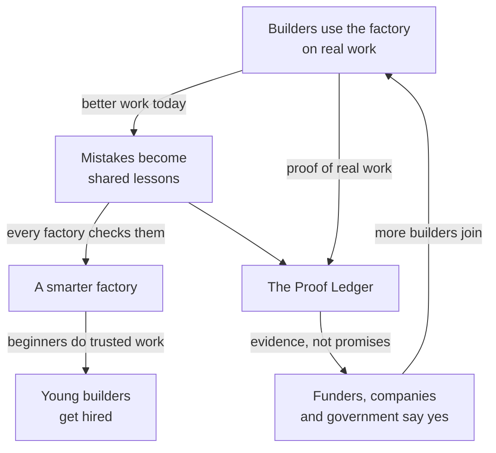

<p align="center"></p>

# The manifesto

AI has made software almost free to create. What it has not made free is trust: the
certainty that what was built actually works. That is now the most valuable thing in
software, and nobody owns it yet.

We are building the proof layer for AI-built software, in the open, and we are building it
in Africa, with the youngest continent on earth.

Every build that passes through the factory leaves proof. Every mistake becomes a check that
protects every builder after it. Every builder who joins makes it smarter for everyone. The
bigger it gets, the more it can be trusted, and the more it can be trusted, the more the
world will build with us.

**Our goal is one million proven builds by African builders.** Every one counted in public,
every one linked to its evidence.

The first 100 are the **Founding Builders**. They will be remembered as the people who proved
Africa could build for the world.

**Start with your next task:**

```bash
npx @next-generation-collective/factory
```

## Why now

1. **AI writes more of the world's code every month, and nobody fully trusts it.** Every team
   that builds with AI has the same problem today: knowing what it built is right.
2. **Africa is the youngest continent on earth, and AI just handed it the same tools as
   Silicon Valley.** Where you are born no longer decides what you can build.
3. **Nobody owns proof yet.** Whoever becomes the standard for "this AI-built work is proven"
   sits at the centre of the AI economy.

## Where the AI economy is going

| Before AI | Now | Where the value goes |
|---|---|---|
| Writing software was slow and expensive | AI writes a growing share of the world's code, fast and nearly free | To proof: knowing what was built is right |
| The money went to whoever could write code | Anyone with a laptop can build | To people who can direct AI and guarantee the result |
| Clients paid for hours | Hours mean less when AI does the typing | To results a client can check |

When something becomes cheap, the value moves to what is still scarce. AI made building
cheap. Trust is now the scarce thing. The factory sits exactly there: it turns AI-built work
into proven work, and it teaches every builder who uses it the judgment the AI economy pays
for.

## The path

Each stage stands on the one before it.

| Stage | What it is | Why it matters |
|---|---|---|
| **1. The tool** | A free, open tool engineers use on every task, because it saves them pain | It gets in everywhere, for free |
| **2. The network** | Every builder's lessons make the factory smarter for every other builder | It gets better the bigger it gets, and cannot be copied late |
| **3. The standard** | "Proven by Next-Gen" becomes the mark people trust on AI-built work | Clients and employers start asking for it |
| **4. The economy** | The largest pool of proven builders on the continent, matched to real work and real funding | Jobs, contracts and capital, built by Africa's young people |

## Why it lasts

The largest technology companies are adding review to their own tools. They can copy a
tool. They cannot copy what grows around it.

| What we build | Why it cannot be copied late |
|---|---|
| **A community that teaches it** | Lessons from real projects across the continent, contributed by builders and owned by no single company |
| **A record nobody can fake** | A public history of proven work. Trust is earned over time; it cannot be bought on launch day |
| **Builders with proof** | A network of young African builders whose work is proven. That is people and trust, not software |
| **Built for here** | African problems, African conditions, African partners |

The tool is the door. The network is the business.

## How the network learns



1. **A builder uses the factory on real work.** It plans properly, checks the result, uses the
   app the way a person would, and a separate AI reviews it. Problems are caught before
   anyone is hurt.
2. **What it caught becomes a lesson.** What went wrong, how to spot it, the check that
   catches it. No client code, no client names. The builder's name goes on it.
3. **Every factory learns it.** Once accepted, every builder on the network is protected from
   that mistake, starting with their next task.
4. **The proof adds up.** Every proven build and every lesson goes on the record that funders,
   companies and government can check for themselves.

## Built in the open

Open source, because proof only counts if anyone can check how it is made.

| Rhythm | What happens |
|---|---|
| **Every week** | Reports and lessons are read, sorted and answered. Nobody waits in silence |
| **Every lesson** | Credited to its author, for good |
| **Every two weeks** | A new release, with a changelog that thanks contributors by name |
| **Always** | Writing a lesson needs no code. Anyone can help the network learn |

The maintainers decide what is accepted into the main version. Everyone else can propose,
report and teach.

## What stays private, and what is shared

| Stays in your project | Shared with the network, on purpose |
|---|---|
| Your code and your client's code | Lessons you choose to share, with your name on them |
| Your specs and proof, unless you publish them | Later, if you choose: counts such as builds proven and first-time approvals |

Nothing leaves your laptop unless you send it. No tracking, no accounts, no analytics.

## The first 100: Founding Builders

The first 100 engineers to use the factory on their real work, every day. What they build
becomes the proof the movement stands on.

### Why build with it every day

| Every day | What you get | What the network gets |
|---|---|---|
| Start each task with `factory "what you are changing"` | A plan that covers what people forget, your tests run, your app used, a second AI checking your work | Proven builds from real projects |
| Share a lesson when the factory catches something | Your name on it, in a public repository, for good | A factory that protects every builder after you |
| Bring one proof page to the weekly show and tell | Feedback, and work you can show anyone | The movement's story, told with evidence |

### What Founding Builders get

1. **Better work now.** Fewer problems reach your users, and a second AI reviews every change.
2. **A proof portfolio.** Evidence of what you built, which says more than any CV.
3. **The skill the AI economy pays for.** Directing AI, and proving what it built is right.
4. **A permanent place.** Your name on the [Founding Builders](FOUNDING-BUILDERS.md) list and
   on every lesson you write.
5. **First in line.** When paid work and funding arrive, Founding Builders get first access,
   and the experienced ones become the paid mentors and reviewers for the builders who
   follow. That is a commitment for *when* the funding comes, not a promise of pay today.

### A Founding Builder's week

**Every task:**

```bash
npx @next-generation-collective/factory "add real-time fraud detection to the payments API"
```

Read the short plan, press `y`, and the factory builds, checks, uses the app and has the work
reviewed. Read the change and commit it yourself.

**When it catches something:** write the lesson down with
`npx @next-generation-collective/factory lesson new`, then share it through the
[Lesson form](https://github.com/next-generation-collective/factory/issues/new?template=lesson.yml).
The next version makes sharing one command.

**Once a week:** a 30-minute show and tell. Everyone shows one proof page: what the factory
caught, what it missed, and what should change.

**When something breaks or feels wrong:** the
[Pilot report](https://github.com/next-generation-collective/factory/issues/new?template=pilot-report.yml)
takes three minutes and decides what gets fixed next.

## What is built today, and what is next

| | Today (0.3) | Next |
|---|---|---|
| Plans, checks, uses the app, independent review, proof | Works | |
| Lessons | Written in your project, shared through a form | Shared with one command |
| Your progress | Proof saved with every build | Your week in numbers, and a shareable proof portfolio |
| The proof mark | | "Proven by Next-Gen" on every proven build |
| The Proof Ledger | | A live public count of every proven build and builder |

The honest list of limits is in [WHAT-IT-CANNOT-DO.md](docs/WHAT-IT-CANNOT-DO.md).

## Join

- **Builders:** start with [PILOT.md](PILOT.md). It takes 10 minutes. Then add yourself to the
  [Founding Builders](FOUNDING-BUILDERS.md).
- **Everyone else:** write a lesson about something that went wrong in software you used or
  built. You do not need to code to help the network learn.
- **Funders, companies and government:** talk to us at
  [nextgencollective.co.za](https://nextgencollective.co.za).

Next-Gen Collective · Africa as builder, not buyer.
